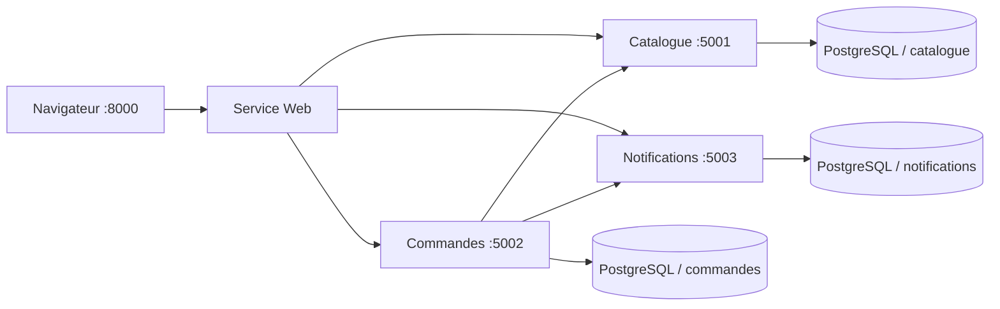

# Maison Zitouna — mini-projet Cloud Computing

Prototype microservices pour une PME tunisienne qui vend des cosmétiques naturels, des huiles essentielles et des savons. Le site monolithique sur un serveur physique unique est remplacé par quatre conteneurs applicatifs et une base PostgreSQL.

## Architecture



Les trois API et la boutique partagent le réseau Docker `artisan-net`. Chaque API a sa propre base, son Dockerfile et son volume de données via le volume `pgdata`.

| Service | Rôle | Persistance | Port |
| --- | --- | --- | --- |
| Catalogue | `GET /products`, réservation de stock | base `catalogue` | 5001 |
| Commandes | `POST /orders`, `GET /orders` | base `commandes` | 5002 |
| Notifications | `POST /notify`, `GET /notifications` | base `notifications` | 5003 |
| Web | Boutique sur http://localhost:8000 | aucune | 8000 |
| PostgreSQL 16 | Trois bases dans un conteneur | volume `pgdata` | interne |

Une commande appelle le catalogue pour réserver le stock, enregistre la commande, puis appelle le service notifications. La réponse contient `notification_id`, ce qui prouve la communication entre microservices.

## Lancer le prototype

Prérequis : Docker Desktop.

```powershell
cd mini-projet-cloud
docker compose build
docker compose up -d
docker ps
```

Ouvrir http://localhost:8000. Le script de vérification :

```powershell
powershell -File scripts/smoke.ps1
```

Réinitialiser les données :

```powershell
docker compose down -v
```

## API utiles

```powershell
curl http://localhost:5001/products
curl -X POST http://localhost:5002/orders -H "Content-Type: application/json" -d "{\"product_id\":1,\"quantity\":1,\"customer_name\":\"Amira Ben Ali\",\"customer_email\":\"amira@example.com\"}"
curl http://localhost:5003/notifications
```

## Bonus couverts

- PostgreSQL dans un conteneur, une base par service.
- Volume persistant `pgdata`, variables d'environnement, réseau `artisan-net`.
- GitHub Actions : construction des images puis test de bout en bout (`scripts/smoke.sh`).

Le workflow se trouve dans `.github/workflows/ci.yml`. Il s'exécute quand ce dossier est la racine du dépôt GitHub.

## Livrables encore à produire à la main

- Export PDF du fichier `RAPPORT.md`.
- Captures : Docker Desktop, `docker ps`, la boutique, une commande qui crée une notification.
- Vidéo de démonstration de 5 à 10 minutes.
- Dépôt GitHub public du groupe, avec ce dossier à la racine.
